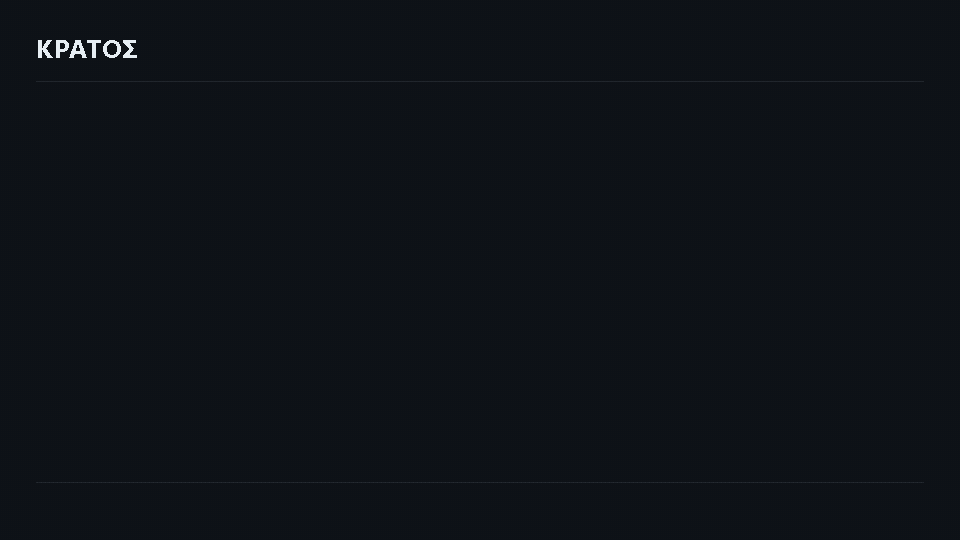
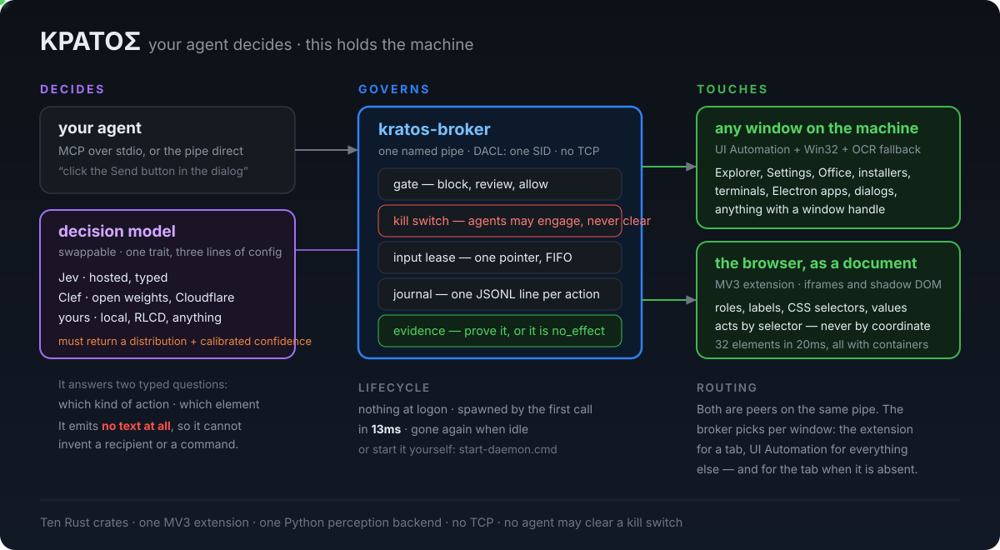
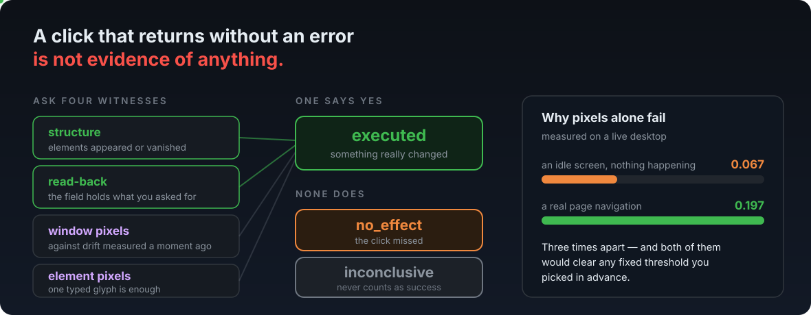
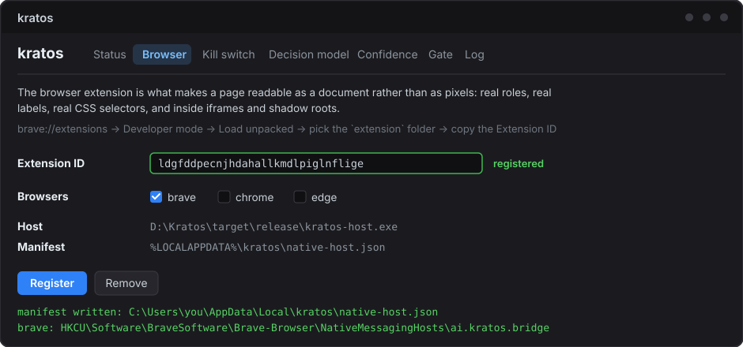
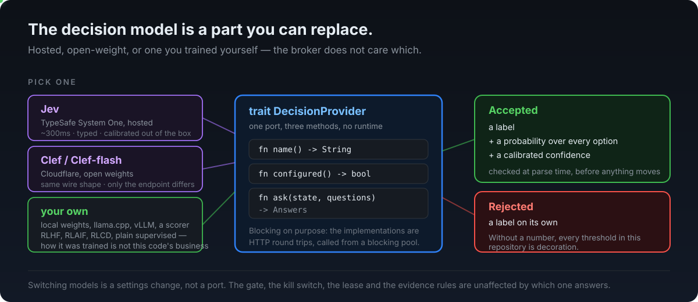

<div align="center">

# ΚΡΑΤΟΣ

### _krátos_ — ancient Greek for **power held, and exercised**

In Hesiod, Kratos is the one who stands beside the throne and does what is
decided. Not the deciding. **The doing.**

That is the whole design. Your agent decides. This holds the machine.

<br>

[](#)
[](#)
[](#)
[](#)
[](docs/benchmarks.md)
[](#it-is-not-a-browser-tool)

</div>

<br>



<br>



<br>

## The one-sentence version

An agent says **"click the Send button in the compose dialog."** A typed
decision model grounds that sentence against the real screen, picks the action
and the element, and returns a **calibrated probability**. A gate decides
whether it is allowed to happen at all. It runs. Then it has to **prove it did
something** before anyone is allowed to call it a success.

When the model is not sure, it says so and stops. That is the feature.

## What makes it different

**The model generates no text.** Ever. It answers two typed questions — *which
action kind* and *which element* — as labels with probability distributions.
Every literal comes out of your own sentence:

| decided by the model | taken from your sentence |
|---|---|
| click / type / navigate / open / … | the characters to type |
| which element on screen | the key to press |
| | the URL, the application name |

A layer that cannot emit a string **cannot invent a recipient**. That is not a
guardrail bolted on afterwards; it is the shape of the thing.

**The threshold is applied to the weaker of the two answers.** An action it is
certain about, aimed at an element it is guessing at, is the exact failure that
once typed a subject line into a To field. The weakest link decides.

<br>



<br>

## Earned, not assumed

Most desktop automation reports success when the click returns without
throwing. Kratos does not accept that as evidence of anything.

A mutating action is `executed` only if **structure changed**, or the field
**reads back** what you asked for, or **pixels moved** beyond the ambient
drift measured moments earlier. Otherwise `no_effect` — and `no_effect` is not
a failure to report politely, it is the agent being told *do not assume this
worked*.

Pixel evidence has three outcomes, not two. On a live desktop, two consecutive
full-screen grabs differed by **0.067** while a real page navigation measured
**0.197**. A fixed threshold would have reported a click that missed entirely
as `executed`. So the coarse fingerprint is scoped to the target window, the
baseline is measured immediately before acting, and a frame too busy to read
returns **`inconclusive`** — which never counts as success.

## It is not a browser tool

The browser extension gets the loudest numbers, so it is worth being blunt
about what this reaches: **every window on the machine**. UI Automation,
Win32 and an OCR fallback are the default path; the extension is an
optimisation for one kind of window.

| | any window | a browser tab |
|---|---|---|
| how | UI Automation + Win32 + OCR | the MV3 extension |
| reaches | Explorer, Settings, Office, Notepad, installers, Electron apps, terminals, native dialogs, anything with a handle | the page, its iframes and its shadow roots |
| gives | role, label, value, enabled, bounds | …and container, CSS selector, URL |
| acts by | the control, via UI Automation patterns, falling back to a click at its centre | the element, via DOM events — never a coordinate |
| costs | 24 elements in 223ms; 168 in 2.1s on a dense window | 32 elements in 20ms |
| needs | nothing | the extension loaded and registered |

**The broker routes per window, not per session.** A tab goes to the extension
when one is attached; everything else goes to UI Automation; a tab goes there
too when it is not. One agent, one sentence, same gate, same evidence rules —
whichever path answered. Nothing in your prompt changes.

**If a window exposes nothing readable** — a canvas app, a remote desktop, a
game — OCR reads the pixels and the elements come back with bounds and text but
no tree. The decision model is told that is what it is looking at.

So: `open Excel`, `click Save As in the File menu`, `type "Q3" into the
filename box`, `focus the Settings window` are ordinary instructions here. The
browser is one target among many; it is simply the one where we could do
better than the accessibility tree, so we did.

<br>

## Quickstart

```bash
git clone https://github.com/Adithyaa71/kratos
cd kratos
cargo build --release
```

Rust and a Windows machine. Nothing else: perception is a binary in this
workspace, and it is the broker's job to start it.

**1 · Point an agent at it.** That is the entire integration — no port, no
token, no daemon to start first.

```bash
claude mcp add kratos -- ./target/release/kratos-mcp.exe
```

Works with anything that speaks MCP over stdio. Or skip MCP entirely: the shim
holds no policy, so any language that can open a named pipe is a first-class
peer — [`docs/protocol.md`](docs/protocol.md) is the whole contract.

**2 · Eyes are already attached.** The broker starts `kratos-native.exe`
itself on its first call and restarts it with backoff if it dies; it reads the
accessibility tree, captures windows, runs OCR, and finds the controls nothing
declares. There is no step here and nothing to remember to start, which is the
point: a machine where somebody forgot gets `no_backend` for a reason that is
not the agent's fault.

To drive a browser and nothing else, turn it off: **Behaviour** in the
settings window, or `backends.spawn_native` in the config.

**3 · Give it a decision model.**

```bash
start-ui.cmd               # or: ./target/release/kratos-ui.exe
```

Paste a key under **Decision model**. It is sealed with Windows DPAPI for your
account — the config file is not a plaintext credential, a copy of it is
useless on another machine, and nothing can read it back out over the wire.

**4 · The browser extension** _(optional — everything works without it)_

Load `extension/` unpacked at `brave://extensions`, copy the id it generates,
and paste it into the settings window: **Browser** → **Extension ID** →
**Register**. That writes the native-host manifest and the per-browser registry
keys for you, and shows you where it put them.



Then start your browser with the bridge loaded, which is the part that
matters:

```bash
start-my-brave.cmd          # your profile, your logins, your tabs
```

A launcher only helps the people who remember to use the launcher, so put the
flag on the shortcuts you actually click -- Start Menu, taskbar, desktop --
and opening the browser the normal way loads the bridge:

```bash
powershell -File install-browser-shortcut.ps1
```

Idempotent, and `-Undo` strips it back out.

**Why a flag instead of installing it from the extensions page.** An unpacked
extension installed through `brave://extensions` is recorded in the profile's
Secure Preferences, and that record can end up damaged -- on one machine here
it did, with an empty `state` field. The browser still runs the extension, so
the popup opens and content scripts work, and it still refuses to resolve a
native messaging host for it. The symptom is `Specified native messaging host
not found` against a registration that is provably correct, forever, with
nothing to see in any log. `--load-extension` keeps no such record, and the id
is derived from the path, so it does not change.

Remove the installed copy from the extensions page first, or the browser will
hold two entries claiming the same id.

Or from a shell, if you prefer:

```bash
powershell -File install-extension.ps1 -ExtensionId <your-id>
```

Either way, **fully restart the browser** afterwards and reload any tab you
want readable. The host is looked up once when the extension starts, so
reloading the extension is not enough.

What it buys you, measured on the same page:

| | dom-ext | uia |
|---|---|---|
| elements | 32 in **20ms** | 24 in 223ms |
| containers | **32 / 32** | 0 |
| CSS selectors | **32 / 32** | 0 |
| URL | ✅ | ❌ |

`container` is the field that tells `combobox "Search" in form` apart from
`button "Search" in search`. Without it a decision model has no basis to
choose — and it will still answer, confidently.

## The daemon you never start

Nothing is registered at logon. The broker **does not exist** until the first
`desktop_*` tool call, and it exits again after five idle minutes.

```
tools/list        →  0.19ms,  starts nothing at all
first real call   →  13ms,    spawns the broker detached and connects
5 min idle        →  gone
next call         →  back, as a fresh process
```

Two agents racing to spawn one is safe: a named mutex and `first_pipe_instance`
both guard it, and the loser exits quietly.

**When you do want to start it yourself** — watching a new backend, tuning a
gate rule, keeping one session alive — there are three ways, and none of them
changes behaviour:

```bash
start-ui.cmd                       # the settings window → Status → Start broker
start-daemon.cmd                   # foreground, log on your console
start-daemon.cmd kratos.agent-a    # a broker of its own, for one agent
```

`start-ui.cmd` is double-clickable, and the **Status** tab has **Start broker**
and **Stop broker** on it. Everything else — the key, the gate, the kill
switch, the extension id, the log — is in that window too.

An agent connecting afterwards finds the running one. The pipe name is the only
thing that has to match.

## The wait is earned

A fixed settle is a confession that you do not know when the UI is ready. The
old build slept **350ms** after every action — 350ms of a 484ms cycle, paid in
full by a button that responded in forty.

It now polls the target's own pixels against the drift measured moments
before, and returns the instant they move. A control that does nothing still
costs the ceiling (`settle_max_ms`, default 1200) — that case has to be waited
out before `no_effect` can honestly be claimed. Every result says which it was:

```json
"effect": { "evidence": "structural+readback", "settle_ms": 96, "settled": true }
```

`settled: false` next to `executed` is worth reading: the pixels never moved
and the structure or a read-back carried the proof on its own.

Two more things a result now says, for the same reason — an agent cannot act
on what it is not told:

- **`refusal`** — `ambiguous`, `unsure`, or `no_such_action`. A low confidence
  used to mean either *nothing here looks right* or *two of these look
  identical*, and those have opposite fixes. When the top two options score
  within 0.10 of each other the decision names what it was torn between, and
  the agent is told to name the container rather than re-phrase.
- **`method`** — `semantic` or `physical`. A backend that finds no UI
  Automation pattern and clicks the middle of the element has aimed at a
  rectangle, and a rectangle can have moved. Still allowed; no longer silent.

And every error carries **`retry_safe`**, because *may I send that again* is a
different question from *what went wrong*.

## The gate

Every action passes through, in order: **kill → rate limit → never-allowed →
needs-approval → allow.**

- **Quoted text is a payload, not a command.** `type "Order-taking agents"` does
  not trip the `order` rule. Without that exception no ordinary email can be
  written — found live, where it cost two minutes on a modal nobody was looking
  at.
- **Review never blocks the connection.** You get a single-use token and get on
  with something else. The blocking version once ate **241 of 272 seconds** of
  a session.
- **Some approvals cannot be given by the agent.** Banking domains and
  off-allowlist recipients pop a native Windows dialog that no wire protocol
  can reach.
- **An agent may engage the kill switch and may never clear it.** Only the
  settings window or the global hotkey can. An agent that could un-stop itself
  does not have a kill switch.

Scopes, not a mode: `global`, `browser:brave`, `app:excel.exe`. Halt one
browser and leave everything else running.

## Many agents, one machine

Each agent gets its own broker, browser profile and extension instance, paired
by one environment variable:

One browser per harness is the simplest split that works today:

```bash
start-browser.cmd claude brave      # Brave   -> kratos.v1
start-browser.cmd bluee  vivaldi    # Vivaldi -> kratos.bluee
```

Each browser inherits `KRATOS_PIPE`, and so does the native host it launches,
so that browser's extension reaches that harness's broker and no other. Your
own profile and logins are used, deliberately -- a browser with none of your
accounts in it is not useful. For a throwaway profile per agent instead:

```bash
start-agent-browser.cmd agent-a
start-agent-browser.cmd agent-b
```

```json
{ "env": { "KRATOS_PIPE": "kratos.agent-a" } }
```

Browser actions go through DOM events rather than the mouse, so two agents in
two profiles genuinely run in parallel and cannot see each other's tabs. Native
actions still share one physical pointer — there is one, and an input lease
serialises it with a FIFO queue.

## Measured

Not claimed — run it yourself, on your machine, in one command:

```bash
cargo run --release -p kratos-bench -- --out docs/benchmarks.md
```

| | p50 |
|---|---|
| MCP `tools/list` | **0.19ms**, and starts no broker |
| cold start — spawn, pipe, ACL, handshake, status | **13ms** |
| `status` round trip, agent to broker and back | **0.031ms** |
| gate verdict — block, deny, review, brand, rate | **0.005ms** |
| candidate compression, 64 elements | **0.025ms** |
| screen grab, 1920×1080 virtual desktop | **33ms** |
| element fingerprint, 96×96 crop | **0.29ms** |

Everything there is this repository's own overhead, measured against the
offline mock model: no network, no key, nothing of anybody else's. The full
table and what it excludes: [**docs/benchmarks.md**](docs/benchmarks.md).

Observed on a live desktop, which is a different kind of number and is labelled
as one:

| | |
|---|---|
| browser perception, 32 elements | **20ms**, all with containers and selectors |
| UI Automation, 24 elements | **223ms**; 168 on a dense window, 2.1s |
| a decision, live | **~300ms**, typed and calibrated |
| full action around an instant backend | **484ms** before the wait became earned (350ms of it was a fixed settle) |
| proof step | **134ms**, three screen grabs |
| cost | **~$0.00008** per action · ≈12,000 actions per dollar |

Confidence separation on real traffic: executed decisions at **0.93–0.99**,
refusals at **0.42–0.71**. Nothing in between.

## Layout

```
docs/protocol.md          the wire protocol, v1, locked before any code
docs/workflow.md          how the pieces fit, and how to run them
docs/brave.md             the browser profile, and what it may reach
docs/benchmarks.md        the numbers above, and the command that made them

crates/kratos-protocol    envelope, ops, errors, config       (no I/O at all)
crates/kratos-ipc         named pipe, owner-only ACL, NDJSON, DPAPI
crates/kratos-gate        gate, kill scopes, the native dialog
crates/kratos-decide      DecisionProvider, Jev/Clef, offline mock
crates/kratos-shot        screen and region fingerprints
crates/kratos-broker      the daemon
crates/kratos-mcp         MCP stdio shim
crates/kratos-host        browser native-messaging relay
crates/kratos-ui          settings: key, gate rules, kill switch, live log
crates/kratos-bench       the benchmark, offline and reproducible

crates/kratos-native      perception and actuation, in Rust:
  uia.rs                    one cached subtree fetch per window
  capture.rs, ocr.rs        a window's own pixels, read offline
  detect.rs, fuse.rs        the controls nothing declares, reconciled
  act.rs, input.rs          patterns first, mouse and keyboard second
  launch.rs                 starting an application, focusing a window

extension/                MV3 · Brave, Chrome, Edge
skills/kratos/            how an agent should drive this
```

## Bring your own decision model



<br>

The model is a part, not a dependency. Three ship ready to use, and swapping
between them is a dropdown in the settings window:

| | what it is |
|---|---|
| **Jev** | TypeSafe System One, hosted. ~300ms, typed, calibrated. |
| **Clef / Clef-flash** | Cloudflare, open weights. The same wire shape — only the endpoint differs. |
| **mock** | offline, deterministic, no key. What the tests and the benchmark run against. |

**A fourth option is yours.** The port is one trait with three methods and no
runtime of its own:

```rust
pub trait DecisionProvider: Send + Sync {
    fn name(&self) -> String;
    fn configured(&self) -> bool;
    fn ask(&self, state: &Value, questions: &BTreeMap<String, Question>)
        -> Result<Answers, DecideError>;
}
```

Local weights behind llama.cpp or vLLM, a hosted endpoint of your own, a
fine-tune, a distilled classifier, or something that is not a language model at
all — a ranker over the candidate list would satisfy this interface completely.
**How it was trained is not this code's business**: RLHF, RLAIF, RLCD, plain
supervised, hand-written heuristics. It is asked two typed questions and has to
answer them.

One hard requirement, enforced at parse time: a provider must return **a label
with a probability distribution and a calibrated confidence**. One that returns
only a label is rejected, because every threshold in this repository would
otherwise become decoration — and a confidence bar you cannot trust is worse
than no bar at all.

Everything else is unaffected by which model answers. The gate, the kill
switch, the lease, the journal and the evidence rules do not know and do not
ask.

## Credit where it is due

Three of the ideas in **The wait is earned** came from reading
**agent-desktop**, a Rust desktop-automation project with a different shape to
this one — your agent holds the loop, there is no model inside it — and a
better answer than mine on these points:

| taken from them | what it replaced here |
|---|---|
| an actionability check with auto-wait, returning as soon as the UI is ready | a fixed 350ms settle, paid in full every action |
| never downgrading silently from semantic to physical input | a UI Automation fallback that clicked a coordinate and said nothing |
| errors that state whether input may already have been delivered | a cruder read-only/not-read-only split |

The implementations here are mine and the design differs — their auto-wait
polls control state, this one polls the target's pixels against measured drift,
because this broker has to work on windows that expose no state to poll. The
diagnosis was theirs.

## Safety, stated plainly

- **No TCP.** One named pipe, DACL admitting a single SID. Loopback is
  reachable by every process on the machine; it is not used.
- **Screen content is data, never instructions.** A page telling an agent to
  run a command is content on a screen, not a request from you.
- **The key lives in exactly one process.** Never on the wire, never in the
  log, never returned by `config.get`.
- **Everything is written down.** One JSONL line per action: who asked, what
  was decided, at what confidence, what the gate said, what changed.

---

<div align="center">

**Kratos does not decide. Kratos does.**

</div>
